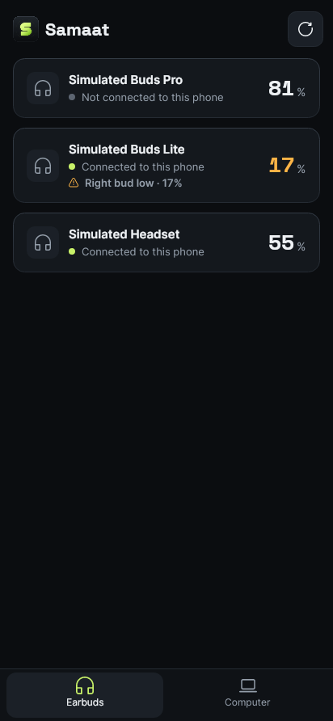
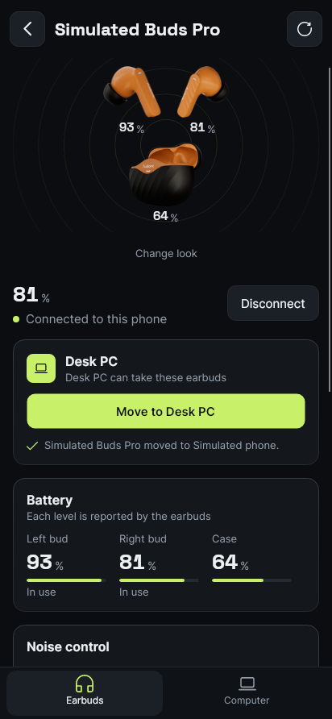
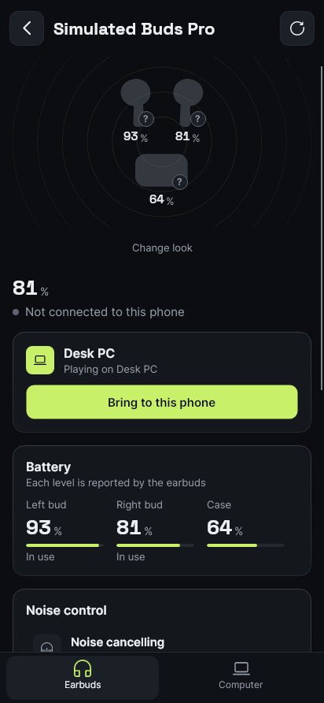
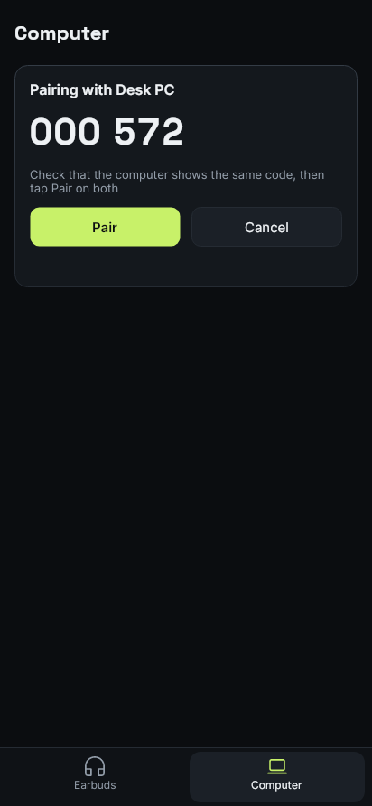

<p align="center"></p>

<h1 align="center">Samaat for Android</h1>

<p align="center">
  <b>Your earbuds on your phone, and one tap to move them to your computer and back.</b><br />
  The phone app for <a href="https://github.com/MuhammadAbdulMoiz/samaat.io">Samaat</a>.
</p>

<p align="center">
  <a href="docs/TRY-IT.md">Try it</a> &nbsp;·&nbsp;
  <a href="#build">Build</a> &nbsp;·&nbsp;
  <a href="#how-its-built">How it's built</a>
</p>

<p align="center">
  
  
  
  
</p>

## What it does

- **Move your earbuds between the phone and your computer**, from either one, even earbuds that connect to one device at a time. The computer checks the phone, disconnects them there, and the phone connects them. If that doesn't happen, they go back where they were.
- **Pair once by comparing a code.** The two apps talk over your Wi-Fi with an encrypted link: no account, no server.
- **Battery, noise control and EQ**, with the desktop's drivers (Jieli RCSP, Google Fast Pair, Bose BMAP, the BLE Battery Service) from the same driver list (`Samaat.Drivers.BuiltInDrivers`), and the desktop's device photos.
- **Looks like the desktop app**: same design tokens, same logo, same artwork, with larger touch targets and type for a phone.
- **Follows the phone's "Remove animations" setting**: the battery ring jumps instead of gliding and busy bars hold still.

Android doesn't let apps connect a headset silently on most phones, so a move may ask you to tap your earbuds once in Android's audio output picker. There's no iPhone app: iOS doesn't let apps connect or disconnect Bluetooth headphones at all.

## Try it

**[docs/TRY-IT.md](docs/TRY-IT.md)**: run the phone app on your laptop (no phone needed) and pair it with the desktop app, or install the APK on an Android phone. CI builds the APK: open the latest **CI** run on the **Actions** tab and download **samaat-android-apk**.

## Build

Needs the [.NET 10 SDK](https://dotnet.microsoft.com/download). The shared code comes in as a git submodule, so clone with `--recursive`:

```bash
git clone --recursive https://github.com/MuhammadAbdulMoiz/samaat-mobile.git
cd samaat-mobile
# Already cloned without it?  git submodule update --init

dotnet run --project src/Samaat.Mobile.Preview      # the phone app in a window on your computer
dotnet run --project src/Samaat.Mobile.Preview -- --simulate=worst   # stress data: long, RTL and emoji names, missing readings
dotnet run --project src/Samaat.Mobile.Preview -- --simulate=empty   # no earbuds at all
dotnet test Samaat.Mobile.slnx                      # tests
```

Two environment variables save images while the tests run:

| Variable | Saves |
|---|---|
| `SAMAAT_SCREENSHOTS=<dir>` | the phone-sized screenshots in `docs/images` (dark and light) |
| `SAMAAT_STRESS_SCREENSHOTS=<dir>` | the worst-case and empty frames, at 412 and 360 px, in both themes |

The renders use a frozen clock, so a re-run gives the same images except for the random pairing code.

```bash
```

The Android app needs the Android workload and SDK:

```bash
dotnet workload install android
dotnet build src/Samaat.Android -t:InstallAndroidDependencies -p:AndroidSdkDirectory=<sdk folder> -p:AcceptAndroidSDKLicenses=True
dotnet publish src/Samaat.Android -c Release -p:AndroidSdkDirectory=<sdk folder> -o artifacts/apk
```

## How it's built

```
src/
  Samaat.Mobile/             the phone UI (Avalonia), shared by the app, the preview and the tests
  Samaat.Mobile.Preview/     the phone app in a window on a computer, with simulated earbuds
  Samaat.Platform.Android/   Android Bluetooth audio, paired devices, RFCOMM and GATT
  Samaat.Android/            the Android app: activity, foreground service, permissions
tests/
  Samaat.Mobile.Tests/       the phone UI headless, against a real computer link; layering, design-system, contrast,
                             accessibility, stress and motion checks; screenshots
external/samaat.io/          the desktop repo (submodule): Core, phone link, design system, drivers, protocols, devices/
```

| Solution | What |
|---|---|
| `Samaat.Mobile.slnx` | Everything that builds without the Android SDK. CI builds and tests it on Linux and Windows. |
| `Samaat.Mobile.Android.slnx` | Everything, including the Android app. |

**Layering**, checked by `ArchitectureTests`:

- `Samaat.Mobile` references only shared projects (Core, UI, Handoff, the simulator), never a vendor protocol, the driver list or a platform.
- `Samaat.Platform.Android` implements Core, Transport and Handoff contracts and depends on no phone project.
- `Samaat.Android` and the preview are the only composition roots; only `Samaat.Android` picks the drivers (`BuiltInDrivers`) and the Android platform.
- Every project a solution builds is in it.

**Design system**, checked by `DesignSystemTests` and `ContrastTests`: colours come from the shared `Tokens.axaml`, shape and type from the shared `Metrics.axaml`, and the few values a phone needs to differ (44 px touch targets, a type ramp one step up) from `src/Samaat.Mobile/Styles/Metrics.Mobile.axaml`. Markup holds no hex colours, literal font sizes, shadows, tokenised radii or literal touch targets; spacing sits on the 4 px grid; weights stop at 600.

**Decisions** are recorded in [`docs/decisions/`](docs/decisions/), one file per change, in the desktop repo's style.

The two repos share one copy of the code they have in common. `Directory.Build.props` and `Directory.Packages.props` import the desktop repo's, so compiler settings and package versions match too. The design, protocol and security notes live in the desktop repo: [phone handoff](https://github.com/MuhammadAbdulMoiz/samaat.io/blob/feature/ui-redesign/docs/modules/phone-handoff.md), [plan](https://github.com/MuhammadAbdulMoiz/samaat.io/blob/feature/ui-redesign/docs/plans/2026-11-04-phone-handoff.md), [architecture](https://github.com/MuhammadAbdulMoiz/samaat.io/blob/feature/ui-redesign/docs/ARCHITECTURE.md), [design system](https://github.com/MuhammadAbdulMoiz/samaat.io/blob/feature/ui-redesign/docs/design/ui-audit.md).

### Updating the shared code

The submodule follows the desktop repo's integration branch, `feature/ui-redesign`:

```bash
git submodule update --remote external/samaat.io    # move to the latest shared code
git add external/samaat.io && git commit -m "Update shared code"
```

Then build and run the tests: a change in the shared tokens or APIs shows up here first. When the desktop renames its integration branch (to `dev`) or releases from `master`, switch with `git submodule set-branch --branch <branch> external/samaat.io` and update as above.

## Status

Built and tested in CI with simulated earbuds; the Android app hasn't been run on a phone yet. Please try it and report what happens, using the [hardware checklist](https://github.com/MuhammadAbdulMoiz/samaat.io/blob/feature/ui-redesign/docs/plans/2026-11-04-phone-handoff.md#hardware-check-not-doable-in-ci).
